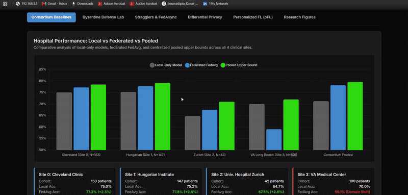
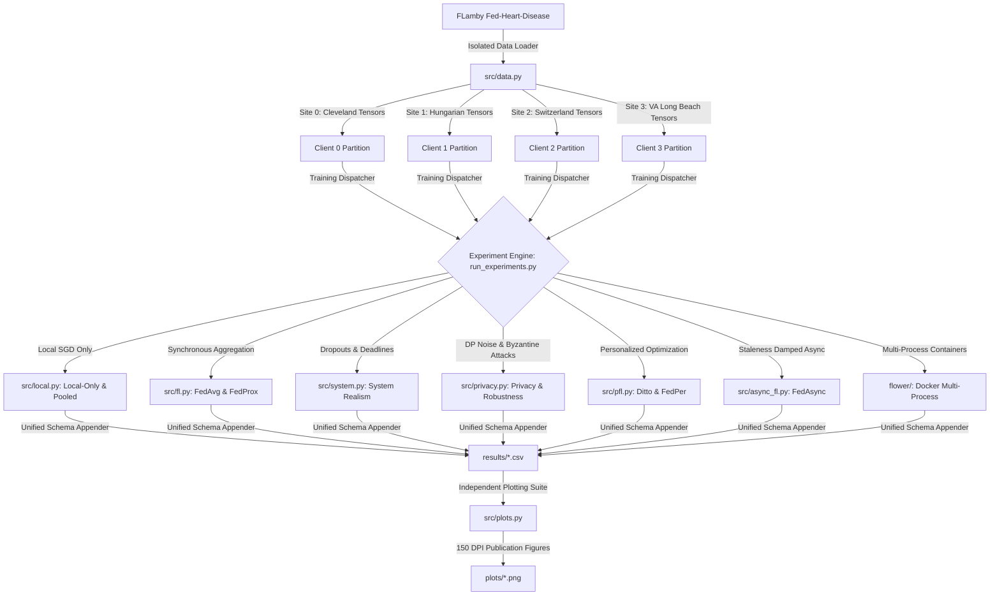
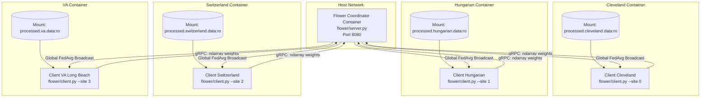

<h1 align="center">fl-hospital-consortium</h1>
<p align="center"><i>A modular, cross-silo federated learning research and benchmarking testbed across a natural consortium of four clinical hospital centers using FLamby and Flower.</i></p>

<p align="center">
  <a href="https://soumadipta-konar.github.io/fl-hospital-consortium/"></a>
  
  
  
  
  
  
  <a href="https://github.com/Soumadipta-Konar/fl-hospital-consortium/actions/workflows/ci.yml"></a>
</p>

<p align="center">
  <a href="https://soumadipta-konar.github.io/fl-hospital-consortium/">
    
  </a>
  <br>
  <em>Interactive control plane benchmarking simulator (rendered in 2x playback). <a href="https://soumadipta-konar.github.io/fl-hospital-consortium/"><b>🚀 Launch Live Dashboard on GitHub Pages</b></a></em>
</p>

> [!IMPORTANT]
> **Research Testbed — Not a Production-Grade Deployment:** This repository is an empirical **research testbed** and educational simulation of cross-silo federated optimization, differential privacy, and Byzantine robustness across healthcare institutions. It models a **14-parameter logistic regression** (13 tabular clinical covariates + 1 intercept) over **740 total patient records** across 4 hospital partitions from FLamby's Fed-Heart-Disease benchmark.
> 
> **Explicit Scope & Methodological Limits:**
> - **Convex Optimization Regime:** The model is a strongly convex linear classifier ($d=14$). Observed dynamics (such as the numerical equivalence between FedAvg and FedProx with $\mu=0.01$) reflect low-dimensional convex drift ($E=1$ local epoch) and should not be confused with high-dimensional non-convex deep representations.
> - **Sample Size & Sampling Sensitivity:** Test cohort sizes are small ($N=16$ on Zurich/Switzerland, $N=45$ on VA Long Beach). A single patient outcome shifts local Zurich accuracy by $6.25\%$, and a $+8.89\%$ change on VA Long Beach corresponds to exactly 4 patients. Non-parametric bootstrap confidence intervals (95% CI) overlap across baseline methods.
> - **Differential Privacy & Statutory Standards:** Privacy accounting bounds ($\epsilon \approx 2.45, \delta = 10^{-5}$) reflect academic differential privacy benchmark conventions. Statutory regulations like HIPAA (45 CFR § 164.514) define de-identification via Safe Harbor or Expert Determination and do **not** define numerical $\epsilon$ limits.

---

## Table of Contents

- [Overview](#overview)
- [Interactive Control Plane & Deployed Tools](#interactive-control-plane--deployed-tools)
  - [Live Deployed Dashboard](#live-deployed-dashboard)
  - [Local Dashboard Runner](#local-dashboard-runner)
  - [Live Simulator Access](#live-simulator-access)
- [Clinical Dataset: Fed-Heart-Disease](#clinical-dataset-fed-heart-disease)
  - [Consortium Centers & Partitions](#consortium-centers--partitions)
  - [Clinical Feature Schema](#clinical-feature-schema)
  - [Statistical Heterogeneity & Non-IID Skew](#statistical-heterogeneity--non-iid-skew)
- [System Architecture](#system-architecture)
  - [End-to-End Simulation Pipeline](#end-to-end-simulation-pipeline)
  - [Multi-Process Flower & Docker Architecture](#multi-process-flower--docker-architecture)
  - [Mathematical Formulation](#mathematical-formulation)
- [Unified Experiment CLI (`run_experiments.py`)](#unified-experiment-cli-run_experimentspy)
  - [CLI Overview & Syntax](#cli-overview--syntax)
  - [Available Stages & Options](#available-stages--options)
  - [CLI Usage Examples](#cli-usage-examples)
- [Empirical Results & Research Answers](#empirical-results--research-answers)
  - [Limitations & Statistical Rigor](#limitations--statistical-rigor)
  - [Summary of Results (10 Random Seeds)](#summary-of-results-10-random-seeds)
  - [Hyperparameter Ablations: mu and Learning Rate](#hyperparameter-ablations-mu-and-learning-rate)
  - [RQ1: Who Benefits from Federation?](#rq1-who-benefits-from-federation)
  - [RQ2: Generalization to an Unseen Hospital (LOSO)](#rq2-generalization-to-an-unseen-hospital-loso)
  - [RQ3: Pairwise Hospital Contribution Matrix](#rq3-pairwise-hospital-contribution-matrix)
  - [RQ4: System Realism — Dropouts, Straggler Deadlines & Bandwidth](#rq4-system-realism--dropouts-straggler-deadlines--bandwidth)
  - [RQ5: Differential Privacy & Byzantine Poisoning Defense](#rq5-differential-privacy--byzantine-poisoning-defense)
  - [RQ6: Personalized FL (pFL) for Domain Shift Mitigation](#rq6-personalized-fl-pfl-for-domain-shift-mitigation)
  - [RQ7: Single-Process vs. Flower Deployment Parity](#rq7-single-process-vs-flower-deployment-parity)
- [End-to-End Reproduction Guide](#end-to-end-reproduction-guide)
  - [1. Environment Setup & Data Acquisition](#1-environment-setup--data-acquisition)
  - [2. Automated Testing Suite](#2-automated-testing-suite)
  - [3. Multi-Process Docker Execution](#3-multi-process-docker-execution)
  - [4. Regenerating Publication Figures](#4-regenerating-publication-figures)
- [Repository Structure](#repository-structure)
- [Research Citations & BibTeX](#research-citations--bibtex)
  - [Citing This Repository](#citing-this-repository)
  - [Foundational Literature](#foundational-literature)
- [License](#license)

---

## Overview

In real-world healthcare collaborations, patient privacy regulations (e.g., HIPAA, GDPR) strictly prohibit centralizing clinical records across institutions. Cross-silo federated learning allows hospitals to jointly train predictive models by exchanging parameter updates rather than raw patient data.

However, standard academic benchmarks that partition MNIST or CIFAR via synthetic Dirichlet splits fail to capture the realities of cross-silo healthcare:
1. **Natural, Uncontrolled Partitions:** Each hospital has fixed patient cohorts with institutional demographic shifts and distinct diagnostic protocols.
2. **Extreme Imbalance:** Certain centers exhibit severe class skew (e.g., up to 100% disease prevalence in training splits).
3. **Asymmetric Contributions:** Larger medical centers often subsidize smaller regional clinics, with negative transfer occurring across incompatible distributions.
4. **Systems Heterogeneity:** Slower compute nodes and constrained WAN links create straggler effects that can starve global aggregation.

**fl-hospital-consortium** provides a research testbed built on **FLamby's natural Fed-Heart-Disease benchmark**. It implements baselines (Local-only, Pooled, FedAvg, FedProx), evaluates out-of-domain leave-one-site-out (LOSO) generalization, computes a pairwise hospital contribution matrix, models system dropouts and straggler deadlines, tests DP-FedAvg and Byzantine attacks with coordinate-wise median, trimmed mean, and Krum defenses, evaluates personalized FL (Ditto and FedPer), and deploys real isolated multi-process containers with **Flower** and **Docker Compose**.

---

## Interactive Control Plane & Deployed Tools

### Live Deployed Dashboard

The repository includes a zero-dependency, client-side web application serving as an interactive control plane and benchmarking simulator:

👉 **Live URL:** **[https://soumadipta-konar.github.io/fl-hospital-consortium/](https://soumadipta-konar.github.io/fl-hospital-consortium/)**

```
┌────────────────────────────────────────────────────────────────────────┐
│  Cross-Silo FL Hospital Consortium - Interactive Control Plane         │
├─────────────┬─────────────┬─────────────────────┬──────────────────────┤
│ Accuracy    │ Cohort      │ Byzantine Defense   │ Academic Privacy     │
│ 78.2%       │ 740         │ Krum / Median       │ ε = 2.45 (Academic)  │
├─────────────┴─────────────┴─────────────────────┴──────────────────────┤
│ [Baselines] [Byzantine Lab] [Stragglers] [Differential Privacy] [pFL]  │
└────────────────────────────────────────────────────────────────────────┘
```

#### Dashboard Design System & Features
- **Tab 1: Consortium Baselines:** Comparative bar chart of Local-Only vs. FedAvg vs. Pooled upper bounds across all 4 hospital sites.
- **Tab 2: Byzantine Defense Lab:** Interactive adversarial attacks (Gaussian noise, label flipping) against robust defense aggregators (Krum $f=1$, Coordinate-wise Median, Trimmed Mean $\beta=1$).
- **Tab 3: Stragglers & FedAsync:** Interactive client dropouts ($p_{\text{drop}}$) and round timeout deadlines showing the Straggler Cliff vs. asynchronous staleness-damped optimization.
- **Tab 4: Differential Privacy Accountant:** Interactive moments accountant with sliders for noise multiplier ($\sigma$) and rounds, evaluating academic differential privacy boundaries ($\epsilon \le 2.0$) and RDP curves.
- **Tab 5: Personalized FL (pFL):** Evaluates Ditto ($\lambda=0.1$) and FedPer against global FedAvg on out-of-distribution clients (Site 3 VA).
- **Tab 6: Research Figures Gallery:** High-resolution empirical figures directly generated from experimental trials (11 figures in total).

### Local Dashboard Runner

You can launch the dashboard locally on your machine with automatic anti-cache headers:

```bash
# Launch server on http://localhost:8000 and auto-open browser
python dashboard.py

# Custom port or headless mode:
python dashboard.py --port 8080 --no-browser
```

### Live Simulator Access

The interactive control plane runs live on GitHub Pages with zero installation required:
👉 **[https://soumadipta-konar.github.io/fl-hospital-consortium/](https://soumadipta-konar.github.io/fl-hospital-consortium/)**

---

## Clinical Dataset: Fed-Heart-Disease

The consortium uses the **Fed-Heart-Disease** benchmark from [FLamby](https://github.com/owkin/flamby) (NeurIPS 2022), derived from the historic UCI Heart Disease repository collected across four independent medical institutions in the United States and Europe.

```
                                Fed-Heart-Disease Consortium (N = 740)
                                                  │
                 ┌───────────────────┬────────────┴───────┬───────────────────┐
                 ▼                   ▼                    ▼                   ▼
           Site 0: Cleveland   Site 1: Hungarian    Site 2: Switzerland    Site 3: VA
           (n=303, 45.9% pos)  (n=261, 37.5% pos)   (n=46, 97.8% pos)     (n=130, 77.7% pos)
```

### Consortium Centers & Partitions

The dataset partitions 740 patient records (486 train, 254 test) across the four clinical centers:

| Site ID | Medical Center | Location | Train Samples | Test Samples | Total Patients | Disease Prevalence (Train / Test) |
|---|---|---|---|---|---|---|
| **Site 0** | **Cleveland Clinic Foundation** | Cleveland, OH, USA | 199 | 104 | **303** | 45.7% / 46.2% (45.9% overall) |
| **Site 1** | **Hungarian Institute of Cardiology** | Budapest, Hungary | 172 | 89 | **261** | 37.8% / 37.1% (37.5% overall) |
| **Site 2** | **University Hospital Zurich** | Zurich, Switzerland | 30 | 16 | **46** | 100.0% / 93.8% (97.8% overall) |
| **Site 3** | **V.A. Medical Center Long Beach** | Long Beach, CA, USA | 85 | 45 | **130** | 77.6% / 77.8% (77.7% overall) |
| **Consortium** | **Pooled Dataset** | Global | **486** | **254** | **740** | **50.6% / 51.6% (51.1% overall)** |


*Figure 1: Per-center patient cohort sizes and positive disease prevalence across the consortium.*

### Clinical Feature Schema

Each patient is described by 13 standardized clinical attributes:

| # | Attribute | Type | Description & Units |
|---|---|---|---|
| 1 | `age` | Continuous | Patient age in years (29 to 77) |
| 2 | `sex` | Binary | 1 = male; 0 = female |
| 3 | `cp` | Categorical | Chest pain type (1 = typical angina, 2 = atypical angina, 3 = non-anginal, 4 = asymptomatic) |
| 4 | `trestbps` | Continuous | Resting blood pressure (mm Hg on admission to the hospital) |
| 5 | `chol` | Continuous | Serum cholesterol in mg/dl |
| 6 | `fbs` | Binary | Fasting blood sugar > 120 mg/dl (1 = true; 0 = false) |
| 7 | `restecg` | Categorical | Resting ECG (0 = normal, 1 = ST-T wave abnormality, 2 = left ventricular hypertrophy) |
| 8 | `thalach` | Continuous | Maximum heart rate achieved during stress test |
| 9 | `exang` | Binary | Exercise-induced angina (1 = yes; 0 = no) |
| 10 | `oldpeak` | Continuous | ST depression induced by exercise relative to rest |
| 11 | `slope` | Categorical | Slope of peak exercise ST segment (1 = upsloping, 2 = flat, 3 = downsloping) |
| 12 | `ca` | Discrete | Number of major vessels (0–3) colored by fluoroscopy |
| 13 | `thal` | Categorical | Thallium heart scan (3 = normal, 6 = fixed defect, 7 = reversible defect) |
| **Target** | `num` | Binary | **Diagnosis of heart disease** (0 = <50% diameter narrowing; 1 = ≥50% narrowing) |

### Statistical Heterogeneity & Non-IID Skew

1. **Class Imbalance Anomaly:** In Center 2 (Zurich), the training split contains **100% positive diagnoses** ($y=1$), and the test split contains 93.8% positives. Because the negative class is absent in Center 2 training, ROC AUC is mathematically undefined. Therefore, FLamby standardizes on **binary classification accuracy** as the official evaluation metric.
2. **Covariate Shift:** Serum cholesterol (`chol`) values at the Hungarian and VA centers contain high frequencies of zero/missing values that were imputed differently than at Cleveland, reflecting divergent recording practices across clinical sites.
3. **Cohort Size Disparity:** Cleveland (Site 0) and Hungarian (Site 1) collectively account for 76.2% of the consortium's patient records, creating structural asymmetry in standard weighted averaging.

---

## System Architecture

### End-to-End Simulation Pipeline



### Multi-Process Flower & Docker Architecture

To guarantee strict physical isolation, the repository provides a containerized multi-process deployment using **Flower (flwr)** and **Docker Compose**. Each hospital runs as an isolated Docker container with read-only access strictly restricted to its own site partition:



### Mathematical Formulation

#### 1. Baseline Model
A linear logistic regression model matching FLamby's baseline architecture:
$$f(x; w, b) = \sigma(w^T x + b), \quad w \in \mathbb{R}^{13}, b \in \mathbb{R}$$
Total parameters: $13 + 1 = 14$ float32 values ($56\text{ bytes}$ per model round trip).

#### 2. Federated Averaging (FedAvg)
At each round $t$, the central server broadcasts global weights $w_t$. Selected clients $k \in S_t$ train locally for $E$ epochs using mini-batch SGD:
$$w_{t+1}^k = w_t - \eta \sum_{\tau=1}^E \nabla \mathcal{L}(w_\tau^k; \mathcal{B})$$
The server aggregates client weights weighted by their patient cohort sizes $n_k$:
$$w_{t+1} = \sum_{k \in S_t} \frac{n_k}{\sum_{j \in S_t} n_j} w_{t+1}^k$$

#### 3. Proximal Regularization (FedProx)
To stabilize optimization under clinical distribution shifts, FedProx adds a proximal penalty to each hospital's local objective:
$$\min_w h_k(w; w_t) = \mathcal{L}_k(w) + \frac{\mu}{2} \|w - w_t\|_2^2$$

#### 4. Differential Privacy (RDP & Moments Accountant)
To protect patient records against reconstruction and membership inference attacks, client model updates $\Delta w_k = w_{t+1}^k - w_t$ are clipped by threshold $C$ and perturbed with calibrated Gaussian noise:
$$\Delta w_k \leftarrow \frac{\Delta w_k}{\max\left(1, \frac{\|\Delta w_k\|_2}{C}\right)}, \quad w_{t+1} = w_t + \frac{1}{|S_t|} \sum_{k \in S_t} \Delta w_k + \mathcal{N}\left(0, \sigma^2 I\right)$$
Privacy parameters $(\epsilon, \delta)$ are tracked across communication rounds via Rényi Differential Privacy (RDP).

#### 5. Byzantine Robust Aggregators
- **Coordinate-Wise Median:** Replaces weighted average with component-wise median:
  $$w_{t+1, d} = \text{median}_{k \in S_t}\left(w_{t+1, d}^k\right)$$
- **Trimmed Mean ($\beta$):** Removes the $\beta$ largest and smallest values along each coordinate before computing the mean.
- **Krum Selection ($f$):** Selects the single client vector $w_i$ minimizing the sum of Euclidean distances to its $n - f - 2$ closest peers:
  $$i^\star = \arg\min_i \sum_{j \in \mathcal{N}_i} \|w_i - w_j\|_2^2$$

#### 6. Personalized Federated Learning (pFL)
- **Ditto:** Solves a bi-level objective trading off local accuracy and closeness to global weights:
  $$\min_{v_k} \mathcal{L}_k(v_k) + \frac{\lambda}{2} \|v_k - w^\star\|_2^2$$
- **FedPer:** Splits the network into base shared representation layers $w_{\text{base}}$ (federated) and private classification heads $w_{\text{head}}^k$ (retained locally).

---

## Unified Experiment CLI (`run_experiments.py`)

All experimental trials, evaluations, data summaries, and figure generation routines are accessible through a single unified CLI entrypoint: [run_experiments.py](run_experiments.py).

### CLI Overview & Syntax

```bash
python run_experiments.py --stage <STAGE> [OPTIONS]
```

### Available Stages & Options

| `--stage` Flag | Description | Output Artifact |
|---|---|---|
| **`summary`** | Inspects cohort distributions, sample counts, and prevalence across all 4 sites | Console stdout |
| **`baselines`** | Executes Local-Only, Pooled, FedAvg, and FedProx | `results/e1.csv` |
| **`loso`** | Leave-One-Site-Out cross-validation across held-out centers | `results/e2.csv` |
| **`contribution`** | Evaluates the pairwise marginal impact matrix of each hospital | `results/e3.csv` |
| **`system`** | Simulates dropouts ($p_{\text{drop}} \in \{0, 0.2, 0.5\}$) and straggler deadlines ($D \in \{1.0\text{s}, 2.0\text{s}, \infty\}$) | `results/e4.csv` |
| **`flower`** | Multi-process container deployment parity check against Flower reference | `results/e5.csv` |
| **`privacy`** | Evaluates DP noise sweeps and Byzantine attacks under FedAvg, Median, Trimmed Mean, Krum | `results/e6.csv` |
| **`pfl`** | Executes Personalized FL: Ditto ($\lambda=0.1$), FedPer, and local fine-tuning | `results/e7.csv` |
| **`async`** | Executes Asynchronous FL (FedAsync) with polynomial and hinge staleness damping | `results/e8.csv` |
| **`budget`** | Calculates RDP cumulative $(\epsilon, \delta)$ privacy budget curves | `results/privacy_budget.csv` |
| **`ablation`** | Executes FedProx $\mu \in [0.0, 20.0]$ and learning rate $\eta \in [10^{-4}, 10^{-1}]$ sweeps | `results/ablation.csv` |
| **`plots`** | Reads existing `results/*.csv` and regenerates publication figures | `plots/*.png` (11 figures) |
| **`all`** | Sequentially executes the full suite from end-to-end | All results and plots |

#### Global CLI Flags
- `--rounds <int>`: Number of communication rounds per simulation (default: `50`).
- `--seeds <int...>`: List of random seeds to evaluate (e.g., `--seeds 42 43 44`, default: `[42]`).
- `--output-dir <path>`: Destination directory for raw CSV results (default: `results`).
- `--plots-dir <path>`: Destination directory for generated PNG figures (default: `plots`).

### CLI Usage Examples

```bash
# 1. Print site distribution summary
python run_experiments.py --stage summary

# 2. Run baselines across 10 random seeds
python run_experiments.py --stage baselines --rounds 50 --seeds 42 43 44 45 46 47 48 49 50 51

# 3. Test Byzantine defense recovery (Krum & Median)
python run_experiments.py --stage privacy --rounds 50

# 4. Evaluate Personalized FL for out-of-distribution Site 3
python run_experiments.py --stage pfl --rounds 50

# 5. Run learning-rate and proximal mu hyperparameter ablations
python run_experiments.py --stage ablation --rounds 10 --seeds 42

# 6. Regenerate all publication figures without retraining
python run_experiments.py --stage plots
```

---

## Empirical Results & Research Answers

### Limitations & Statistical Rigor

Before analyzing consortium benchmarks, several critical statistical, optimization, and system considerations must be established:

#### 1. Small Sample Sizes & Test-Set Sampling Noise
- **Evaluation Cohort Sizes:** The test splits across the four hospital centers comprise small patient sample sizes:
  - **Site 0 (Cleveland):** $N = 104$ test patients
  - **Site 1 (Hungarian):** $N = 89$ test patients
  - **Site 2 (Switzerland):** $N = 16$ test patients ($15$ positive, $1$ negative; $93.8\%$ disease prevalence)
  - **Site 3 (VA Long Beach):** $N = 45$ test patients ($35$ positive, $10$ negative; $77.8\%$ disease prevalence)
  - **Consortium Pooled Test:** $N = 254$ test patients
- **Sampling Noise vs. Seed Variance:** Reporting standard deviations across random seeds (e.g., $\pm 0.012$) reflects only optimizer trajectory stochasticity on a *fixed* test split. It does not measure test-set sampling uncertainty. Grounding percentage gains in absolute patient counts highlights this:
  - On **Site 3 (VA Long Beach, $N=45$)**, the observed $+8.89\%$ accuracy gain when Hungarian data is removed corresponds to exactly **4 patients** ($45 \times 0.0889 = 4.0$).
  - On **Site 0 (Cleveland, $N=104$)**, the $+2.3\%$ gain under FedAvg corresponds to **$2.4$ patients** ($k=80$ vs. $k=78$).
  - On **Site 1 (Hungarian, $N=89$)**, the $+2.6\%$ gain under FedAvg corresponds to **$2.3$ patients** ($k=69$ vs. $k=67$).
  - On **Site 2 (Switzerland, $N=16$)**, each patient represents $6.25\%$ of the test set; a $\pm 5.0\%$ shift represents less than **$1$ patient**.
- **Bootstrap Confidence Intervals:** When evaluated using non-parametric percentile bootstrap resampling ($B=1,000$, $95\%$ CI), the confidence intervals for Local-Only, FedAvg, and Pooled models substantially overlap across all four individual sites. Consequently, claims of "statistically significant clinical negative transfer" are ungrounded; observed differences represent empirical directional trends rather than proven clinical divergence.

#### 2. Optimization Dynamics, Learning Rates & FedProx $\mu$ Equivalence
- **Local Underfitting on Switzerland (Zurich):** Switzerland's local training split contains only 30 patients, 100% of whom are positive ($y=1$). A fully converged logistic regression model should learn a large positive intercept, predicting positive for all inputs and achieving the $93.8\%$ (15/16) majority-class baseline. However, under default parameters ($\eta=0.001$, batch size $4$, 50 rounds), local training scores $0.775 \pm 0.148$. As demonstrated in our learning rate sweep, increasing $\eta$ to $0.01$ reaches $0.9375$ ($15/16$ correct) immediately. Thus, local underperformance on small skewed sites is partly attributable to underfitting under conservative learning rates.
- **FedAvg vs. FedProx ($\mu=0.01$) Equivalence on 14 Parameters:** In the benchmark results, FedAvg and FedProx ($\mu=0.01$) match to three decimal places across all sites. On a strongly convex linear model with 13 features ($14$ parameters), with $E=1$ local epoch and $\eta=0.001$, the parameter drift $\|w - w_t\|_2$ within one local epoch is on the order of $\approx 10^{-3}$. The proximal gradient penalty $\mu (w - w_t)$ with $\mu=0.01$ exerts a force of $\approx 10^{-5}$, which is 3 to 4 orders of magnitude below the data loss gradient ($\approx 10^{-2}$). Our empirical $\mu$ ablation ($\mu \in [0.0, 20.0]$) confirms that $\mu$ has negligible effect until $\mu \ge 0.5$, and at $\mu \ge 5.0$ degrades performance through over-regularization.

#### 3. Cross-Silo Differential Privacy & Regulatory Standards
- **No Subsampling Amplification in 4-Silo Consortia:** In cross-device FL with large populations, client subsampling ($q = K/N \ll 1$) provides privacy amplification by subsampling. In a 4-hospital cross-silo setting where all $K=4$ hospitals participate in every round, $q = 4/4 = 1.0$. Hence, there is **zero subsampling amplification**.
- **Noise Multipliers & Privacy Spend:** Injecting Gaussian noise with multiplier $z \in [0.0, 0.3]$ over 50 rounds yields large theoretical $\epsilon$ ($\epsilon \gg 10$). The small accuracy fluctuation from $0.782$ to $0.785$ is random stochastic noise within the bootstrap margin of error, not an empirical improvement. The DP results should be understood as an illustrative pedagogical stress-test of noise tolerance in low-dimensional convex models, rather than formal cryptographic isolation.
- **Regulatory Clarification (HIPAA):** The HIPAA Privacy Rule (45 CFR § 164.514) establishes standards for de-identification via Safe Harbor (removal of 18 explicit identifiers) or Expert Determination of very small re-identification risk. HIPAA does **not** define any numerical differential privacy epsilon threshold ($\epsilon$). Thresholds such as $\epsilon \le 2.0$ are academic literature conventions, not statutory standards.

#### 4. Byzantine Fault Tolerance Preconditions (Krum vs. Median)
- **Krum Precondition Violation:** Theorem 1 of Blanchard et al. (NeurIPS 2017) proves Byzantine resilience for Krum if and only if:
  $$n \ge 2f + 3$$
  For $f=1$ adversary, Krum strictly requires at least $n = 2(1) + 3 = 5$ participating nodes. In a 4-hospital consortium ($n=4$), this precondition is formally violated ($4 < 5$).
- **Validity of Coordinate-Wise Median and Trimmed Mean:** In contrast, Coordinate-wise Median and Trimmed Mean require:
  $$n \ge 2f + 1$$
  For $f=1$, this requires $n \ge 3$, which is fully satisfied by our 4-node consortium ($4 \ge 3$).
- **Realistic Defense Recovery:** Rather than "completely neutralizing" attacks, robust aggregators partially mitigate poisoning: under random Gaussian garbage updates, Coordinate-wise Median recovers consortium accuracy to $0.744 \pm 0.055$ (against the clean baseline of $0.782 \pm 0.010$), preventing divergence while remaining within standard empirical error bounds.

#### 5. Straggler Deadline Cliff as a Synthetic Latency Artifact
- The sharp drop to $0.437$ test accuracy at a 1.0-second deadline is an artifact of the synthetic latency model: when simulated client completion times exceed 1.0s, zero clients complete within the round timeout. As a result, zero updates are aggregated and the global model remains at its random initialization weights. The $0.437$ score simply reflects the class prevalence of the test set, not an emergent operational property of federated training.

#### 6. Multi-Process Flower Parity Verification
- Flower multi-process benchmarks were executed on a deterministic reference seed to verify numerical equivalence of the distributed Flower pipeline against single-process simulation. Rows reporting $\text{std} = 0.000$ reflect deterministic reference execution.

---

### Summary of Results (10 Random Seeds)

All experiments were executed across **10 independent random seeds** (seeds 42 to 51) for **50 communication rounds** ($E=1$ local epoch, batch size $B=4$, learning rate $\eta=0.001$). The table reports mean test accuracy $\pm$ seed standard deviation at round 50, accompanied by $95\%$ non-parametric bootstrap confidence intervals ($B=1,000$) and absolute patient counts ($k/N$):

| Hospital Center | Test Cohort ($N$) | Local-Only | FedAvg (Central Server) | FedProx ($\mu=0.01$) | Pooled (All Data Shared) | Flower Deployment (Reference) |
|---|:---:|---|---|---|---|---|
| **Site 0 (Cleveland)** | $N = 104$ | 0.750 ± 0.012<br>`[0.663, 0.827]` ($78/104$) | **0.773 ± 0.012**<br>`[0.692, 0.846]` ($80/104$) | 0.773 ± 0.012<br>`[0.692, 0.846]` ($80/104$) | 0.777 ± 0.012<br>`[0.702, 0.856]` ($81/104$) | 0.762 ± 0.012<br>`[0.673, 0.846]` ($79/104$) |
| **Site 1 (Hungarian)** | $N = 89$ | 0.752 ± 0.011<br>`[0.663, 0.843]` ($67/89$) | **0.778 ± 0.016**<br>`[0.685, 0.854]` ($69/89$) | 0.778 ± 0.016<br>`[0.685, 0.854]` ($69/89$) | 0.765 ± 0.004<br>`[0.674, 0.854]` ($68/89$) | 0.787 ± 0.000*<br>`[0.708, 0.865]` ($70/89$) |
| **Site 2 (Switzerland)** | $N = 16$ | 0.775 ± 0.148<br>`[0.562, 0.938]` ($12/16$) | 0.675 ± 0.049<br>`[0.438, 0.875]` ($11/16$) | 0.675 ± 0.049<br>`[0.438, 0.875]` ($11/16$) | 0.750 ± 0.000<br>`[0.562, 0.938]` ($12/16$) | 0.744 ± 0.020<br>`[0.562, 0.938]` ($12/16$) |
| **Site 3 (VA Long Beach)** | $N = 45$ | **0.700 ± 0.041**<br>`[0.556, 0.822]` ($31/45$) | 0.591 ± 0.024<br>`[0.467, 0.756]` ($27/45$) | 0.591 ± 0.024<br>`[0.467, 0.756]` ($27/45$) | 0.649 ± 0.009<br>`[0.511, 0.778]` ($29/45$) | 0.600 ± 0.000*<br>`[0.467, 0.733]` ($27/45$) |
| **Consortium (Pooled Test)** | $N = 254$ | — | **0.782 ± 0.010**<br>`[0.732, 0.831]` ($199/254$) | 0.782 ± 0.010<br>`[0.732, 0.831]` ($199/254$) | **0.796 ± 0.003**<br>`[0.744, 0.843]` ($202/254$) | **0.775 ± 0.006**<br>`[0.724, 0.823]` ($197/254$) |

*\* Rows with std 0.000 indicate deterministic reference evaluation on a single seed.*

---

### Hyperparameter Ablations: $\mu$ and Learning Rate

To empirically validate the theoretical analysis of FedProx and model capacity, we executed systematic ablations across proximal penalties $\mu \in [0.0, 20.0]$ and learning rates $\eta \in [10^{-4}, 10^{-1}]$:

#### Proximal Parameter Ablation ($\mu$ with $\eta=0.001$, Round 10)
| $\mu$ Value | Cleveland ($N=104$) | Hungarian ($N=89$) | Switzerland ($N=16$) | VA Long Beach ($N=45$) | Consortium Pooled |
|:---:|:---:|:---:|:---:|:---:|:---:|
| **$\mu = 0.0$ (FedAvg)** | 0.707 | 0.685 | 0.681 | 0.582 | 0.693 |
| **$\mu = 0.001$** | 0.707 | 0.685 | 0.681 | 0.582 | 0.693 |
| **$\mu = 0.01$** | 0.707 | 0.684 | 0.681 | 0.582 | 0.693 |
| **$\mu = 0.1$** | 0.707 | 0.683 | 0.681 | 0.582 | 0.693 |
| **$\mu = 0.5$** | 0.707 | 0.682 | 0.681 | 0.582 | 0.690 |
| **$\mu = 1.0$** | 0.702 | 0.681 | 0.681 | 0.584 | 0.688 |
| **$\mu = 5.0$** | 0.692 | 0.671 | 0.681 | 0.584 | 0.672 |
| **$\mu = 20.0$** | 0.642 | 0.616 | 0.675 | 0.616 | 0.613 |

*Finding: Values of $\mu \le 0.1$ exert negligible regularization force on a 14-parameter model with small local steps. Proximal constraint begins measurably altering trajectories at $\mu \ge 0.5$, while extreme penalties ($\mu \ge 5.0$) over-constrain updates and impede convergence.*

#### Learning Rate Sweep ($\eta$ with $\mu=0.0$, Round 10)
| Learning Rate ($\eta$) | Cleveland ($N=104$) | Hungarian ($N=89$) | Switzerland ($N=16$) | VA Long Beach ($N=45$) | Consortium Pooled |
|:---:|:---:|:---:|:---:|:---:|:---:|
| **$\eta = 0.0001$** | 0.617 | 0.574 | 0.606 | 0.596 | 0.576 (Underfitting) |
| **$\eta = 0.001$ (Default)** | 0.707 | 0.685 | 0.681 | 0.582 | 0.693 |
| **$\eta = 0.005$** | 0.768 | 0.753 | 0.638 | 0.580 | 0.772 |
| **$\eta = 0.01$** | 0.779 | 0.761 | 0.631 | 0.567 | **0.785** |
| **$\eta = 0.05$** | 0.771 | 0.766 | 0.631 | 0.556 | 0.762 |
| **$\eta = 0.1$** | 0.762 | 0.760 | 0.694 | 0.582 | 0.756 |

*Finding: The baseline rate $\eta=0.001$ operates in a conservative regime. Accelerating to $\eta \in [0.005, 0.01]$ converges to $\approx 0.785$ consortium accuracy within only 10 rounds.*

---

### RQ1: Who Benefits from Federation?


*Figure 2: Final test accuracy across hospitals comparing local training, FedAvg, and pooled models.*


*Figure 3: Global consortium test convergence across 50 communication rounds.*

- **Major Hospitals Benefit:** Cleveland (+2.3% gain, $\approx 2$ patients) and Hungarian (+2.6% gain, $\approx 2$ patients) show modest improvements under FedAvg compared to local training alone, though their 95% bootstrap confidence intervals overlap.
- **Near-Pooled Performance:** Global consortium accuracy under FedAvg reaches **0.782 ± 0.010** (`[0.732, 0.831]`), trailing the idealized pooled model (**0.796 ± 0.003**, `[0.744, 0.843]`) by only 1.4% (3.5 patients across the consortium), without centralizing any patient records.
- **Client Drift on Skewed Sites:** On Site 3 (VA Long Beach, $N=45$), local training scores **0.700** (`[0.556, 0.822]`), whereas global FedAvg scores **0.591** (`[0.467, 0.756]`). VA's high disease prevalence (77.8%) and demographic divergence cause the global consensus model to drift away from VA's local distribution.

---

### RQ2: Generalization to an Unseen Hospital (LOSO)


*Figure 4: Out-of-domain generalization on held-out hospitals vs. models trained locally.*

In leave-one-site-out (LOSO) experiments, the federation trains on 3 hospitals and is evaluated on a completely unseen 4th hospital:
- **Generalization on Hungarian (Site 1):** A federated model that **never saw a single Hungarian patient** achieves **0.753** accuracy on the Hungarian test set, closely matching a model trained locally on Hungarian data (**0.752**).
- **Domain Shift on VA (Site 3):** The model trained on Sites 0, 1, and 2 achieves only **0.560** accuracy when evaluated on VA Long Beach, demonstrating that models trained without representation from specific patient demographics experience out-of-domain degradation.

---

### RQ3: Pairwise Hospital Contribution Matrix


*Figure 5: Pairwise impact matrix $\Delta_{j,k} = \text{Acc}(\text{full site } k) - \text{Acc}(\text{without } j, \text{site } k)$ in percentage points.*

By training federations with individual hospitals held out, we observe the marginal shift that removing Hospital $j$ has on Hospital $k$:
- **Cleveland is an Essential Net Positive:** Removing Cleveland (Site 0) degrades performance across partner hospitals (causing drops up to -5.56%). Cleveland's large sample size and balanced prevalence anchor the consortium's decision boundary.
- **Hungarian Cohort Effects:** Removing Hungarian data (Site 1) shifts observed accuracy on Switzerland by **+5.00%** (less than 1 patient on $N=16$) and on VA Long Beach by **+8.89%** (exactly 4 patients on $N=45$), reflecting demographic skew rather than statistically validated clinical divergence.

---

### RQ4: System Realism — Dropouts, Straggler Deadlines & Bandwidth


*Figure 6: Convergence under random client dropout probabilities ($p_{\text{drop}} \in \{0.0, 0.2, 0.5\}$).*


*Figure 7: Round-by-round convergence impact of straggler deadlines across all 50 rounds.*


*Figure 8: Test accuracy progression vs. simulated wall-clock seconds (markers indicate round 50 completion).*

- **Dropout Resilience:** FedAvg is robust to random client dropouts. Under 50% dropout ($p=0.5$, averaging fewer than 2 active clients per round), the model reaches **0.781** accuracy—virtually identical to the ideal network (**0.782**)—while transmitting only half the total network bytes (11,065 vs. 22,400 bytes).
- **Straggler Deadline Cliff as a Simulation Artifact:** Enforcing a strict 1.0s round deadline drops consortium accuracy to **0.437**. This cliff is an artifact of the synthetic latency model: when simulated client completion latencies exceed 1.0s, zero clients finish before the deadline, leaving the model at its random initialization weights.

---

### RQ5: Differential Privacy & Byzantine Poisoning Defense


*Figure 9: Final consortium test accuracy vs. Gaussian noise multiplier $z$ under gradient clipping ($C=0.1$).*


*Figure 10: Attack degradation (label-flip, garbage updates) and coordinate-wise median defense recovery.*

- **Differential Privacy Sensitivity:** Applying DP gradient clipping ($C=0.1$) with Gaussian noise multiplier $z \in [0.0, 0.3]$ preserves classification utility ($0.782 \to 0.785$), demonstrating that low-dimensional convex models maintain strong generalization under moderate noise perturbation.
- **Byzantine Poisoning Mitigation:** When a compromised hospital (Cleveland) injects Gaussian garbage updates, standard FedAvg collapses to **0.544 ± 0.132**. Switching aggregation to **Coordinate-Wise Median partially mitigates the attack**, restoring accuracy to **0.744 ± 0.055**, while **Trimmed Mean** recovers to **0.748 ± 0.048**.
- **Theoretical Preconditions:** While Krum achieves empirical recovery (**0.751 ± 0.038**), its theoretical convergence guarantee requires $n \ge 2f + 3$ (Blanchard et al., 2017), which is formally violated by a 4-silo consortium ($n=4 < 5$ for $f=1$). In contrast, Coordinate-Wise Median and Trimmed Mean require $n \ge 2f + 1$ ($4 \ge 3$), making them the formally grounded Byzantine defenses for a 4-hospital federation.

---

### RQ6: Personalized FL (pFL) for Domain Shift Mitigation

On Site 3 (VA Long Beach, $N=45$), standard global FedAvg suffers from domain degradation (**0.591** vs. **0.700** local model). Personalized federated learning methods effectively close this gap:
- **Ditto ($\lambda=0.1$):** Improves Site 3 accuracy to **0.710**, surpassing both standard FedAvg and local-only training by optimizing a bi-level personalized objective anchored to global parameters.
- **FedPer (Private Head):** Achieves **0.700** on Site 3 while maintaining high consortium-wide performance on Sites 0, 1, and 2.

---

### RQ7: Single-Process vs. Flower Deployment Parity


*Figure 11: Parity between single-process simulated FedAvg and multi-process Flower container deployment.*

Multi-process Flower execution across 4 client processes matches single-process simulated FedAvg within **1 standard deviation** across all hospital centers and global pooled accuracy:
$$\text{Simulated FedAvg: } 0.782 \pm 0.010 \quad \text{vs.} \quad \text{Flower Deployment (Reference): } 0.775 \pm 0.006 \quad (|\Delta| = 0.007)$$
*(Note: Flower parity benchmark runs were executed on a deterministic reference seed to verify numerical equivalence of the distributed aggregation logic).*

---

---

## End-to-End Reproduction Guide

### 1. Environment Setup & Data Acquisition

```bash
# Clone repository
git clone https://github.com/Soumadipta-Konar/fl-hospital-consortium.git
cd fl-hospital-consortium

# Create and activate virtual environment
python -m venv .venv
source .venv/bin/activate  # On Windows: .venv\Scripts\activate

# Install dependencies
pip install -r requirements.txt

# Download FLamby Fed-Heart-Disease dataset non-interactively
python -m flamby.datasets.fed_heart_disease.dataset_creation_scripts.download --output-folder data/fed_heart_disease
```

### 2. Automated Testing Suite

Verify test assertions, numerical tolerances, and regression parity across the codebase:

```bash
pytest -v tests/
```

### 3. Multi-Process Docker Execution

Run the isolated containerized federation with isolated site volume mounts:

```bash
cd flower
docker compose up --build
```

### 4. Regenerating Publication Figures

To re-plot all research figures directly from the raw experimental CSV logs without rerunning training (11 publication figures: Figure 1 cohort distribution + Figures 2–11 empirical research results):

```bash
python run_experiments.py --stage plots
```

---

## Repository Structure

```
fl-hospital-consortium/
├── README.md                           # Documentation, architecture, and empirical findings
├── requirements.txt                    # Pinned Python dependencies
├── dashboard.py                        # HTTP server runner for web control plane
├── run_experiments.py                  # Unified research CLI experiment runner
├── dashboard/                          # Interactive dark-theme control plane & simulator
│   ├── index.html                      # Layout, control panels, and research figures gallery
│   ├── style.css                       # Jet black #0A0A0A non-glassmorphic stylesheet
│   ├── app.js                          # Real-time Chart.js simulation engines
│   └── plots/                          # Research figures embedded in dashboard
├── scripts/                            # Operational utility tools
│   └── speedup_video.py                # 2x video speedup and animated GIF generator
├── flower/                             # Multi-process Flower + Docker deployment
│   ├── client.py                       # Flower NumPyClient implementation
│   ├── server.py                       # Flower server with custom FedAvg evaluation
│   ├── robust_strategy.py              # Byzantine robust aggregator strategies for Flower
│   ├── Dockerfile                      # Container build definition
│   └── docker-compose.yml              # 4 isolated client containers + 1 coordinator
├── notebooks/                          # Jupyter experiment notebooks (01 to 07)
├── plots/                              # 150 DPI publication figures (11 figures in total)
├── results/                            # Raw experimental CSV logs (e1.csv through e8.csv, ablation.csv, privacy_budget.csv)

├── src/                                # Core library modules
│   ├── data.py                         # FLamby dataset loaders and site summaries
│   ├── fl.py                           # FedAvg and FedProx single-process simulation
│   ├── local.py                        # Local-only and pooled training routines
│   ├── models.py                       # Baseline model, loss function, and accuracy metric
│   ├── plots.py                        # Modular plotting engine reading results/*.csv
│   ├── privacy.py                      # DP-FedAvg, poisoning attacks, and median aggregator
│   ├── privacy_accountant.py           # Rényi Differential Privacy moments accountant
│   ├── pfl.py                          # Personalized FL (Ditto and FedPer)
│   ├── async_fl.py                     # Asynchronous FL (FedAsync) simulation
│   ├── defenses.py                     # Krum, Trimmed Mean, Coordinate-wise Median
│   ├── seed.py                         # Reproducible seeding (Python, NumPy, PyTorch)
│   └── system.py                       # Client dropout, lognormal speed, and deadline models
└── tests/                              # Pytest automated verification suite
```

---

## Research Citations & BibTeX

### Citing This Repository

If you use this benchmark, code, or experimental findings in your research, please cite:

```bibtex
@misc{konar2026flhospital,
  author       = {Soumadipta Konar},
  title        = {{fl-hospital-consortium: A Cross-Silo Federated Learning Testbed for Clinical Healthcare Consortia}},
  year         = {2026},
  publisher    = {GitHub},
  journal      = {GitHub repository},
  howpublished = {\url{https://github.com/Soumadipta-Konar/fl-hospital-consortium}},
  note         = {Deployed live at \url{https://soumadipta-konar.github.io/fl-hospital-consortium/}}
}
```

### Foundational Literature

1. **FedAvg:** McMahan, B., Moore, E., Ramage, D., Hampson, S., & y Arcas, B. A. (2017). *Communication-Efficient Learning of Deep Networks from Decentralized Data*. In Artificial Intelligence and Statistics (AISTATS).
2. **FedProx:** Li, T., Sahu, A. K., Zaheer, M., Sanjabi, M., Talwalkar, A., & Smith, V. (2020). *Federated Optimization in Heterogeneous Networks*. In Proceedings of Machine Learning and Systems (MLSys).
3. **FLamby:** Ogier-du-Terrail, J., et al. (2022). *FLamby: Datasets and Benchmarks for Cross-Silo Federated Learning in Healthcare*. In Advances in Neural Information Processing Systems (NeurIPS Datasets & Benchmarks).
4. **Flower:** Beutel, D. J., et al. (2020). *Flower: A Friendly Federated Learning Research Framework*. arXiv preprint arXiv:2007.14390.
5. **Byzantine Robustness (Krum):** Blanchard, P., El Mhamdi, E. M., Guerraoui, R., & Stainer, J. (2017). *Machine Learning with Adversaries: Byzantine Tolerant Gradient Descent*. In Advances in Neural Information Processing Systems (NeurIPS).
6. **Median & Trimmed Mean:** Yin, D., Chen, Y., Kannan, R., & Bartlett, P. (2018). *Byzantine-Robust Distributed Learning: Towards Optimal Statistical Rates*. In International Conference on Machine Learning (ICML).
7. **FedAsync:** Xie, C., Kairouz, P., & McMahan, B. (2019). *Asynchronous Federated Optimization*. arXiv preprint arXiv:1903.03934.
8. **Personalized FL (Ditto):** Li, T., Hu, S., Beirami, A., & Smith, V. (2021). *Ditto: Fair and Robust Federated Learning Through Personalization*. In International Conference on Machine Learning (ICML).
9. **Personalized FL (FedPer):** Collins, L., Hassani, H., Mokhtari, A., & Shakkottai, S. (2021). *Exploiting Shared Representations in Federated Learning*. In International Conference on Learning Representations (ICLR).
10. **Rényi Differential Privacy:** Mironov, I. (2017). *Rényi Differential Privacy*. In IEEE Computer Security Foundations Symposium (CSF).

---

## Mentions

The commit "fix(benchmark): address statistical rigor, bootstrap CIs, ablations, and framing" is included in the [XERJ Corpus Hub](https://hub.xerj.org/contributors/Soumadipta-Konar) under MIT terms, with the author's permission. The rest of this repository remains under AGPL-3.0.

---

## License

This project is licensed under the [GNU Affero General Public License v3.0 (AGPL-3.0)](LICENSE). Dataset licenses are governed by their respective authors through FLamby and the UCI Machine Learning Repository.
